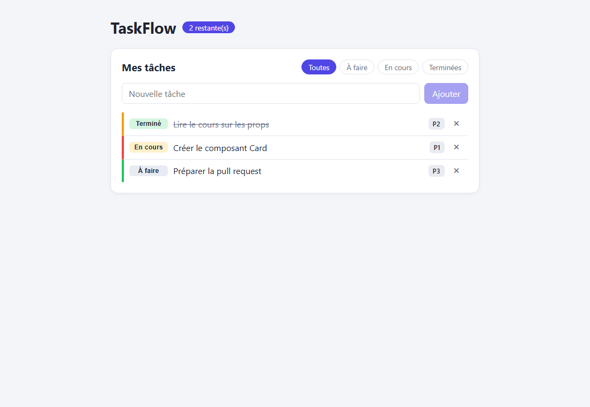
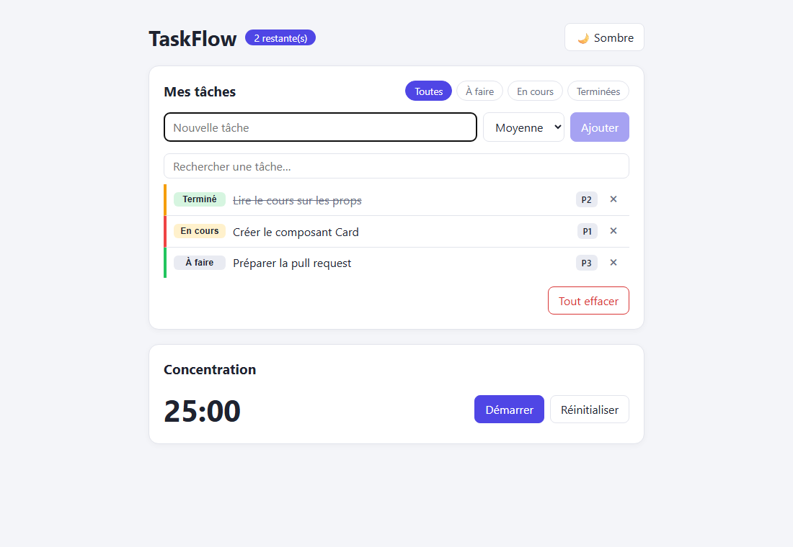
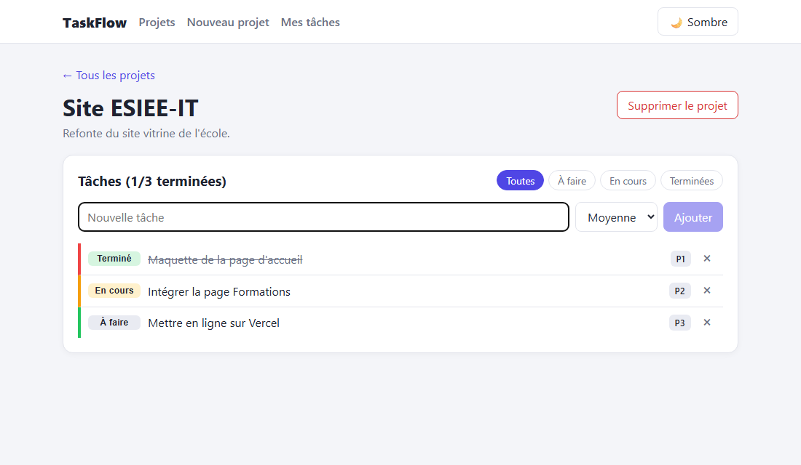
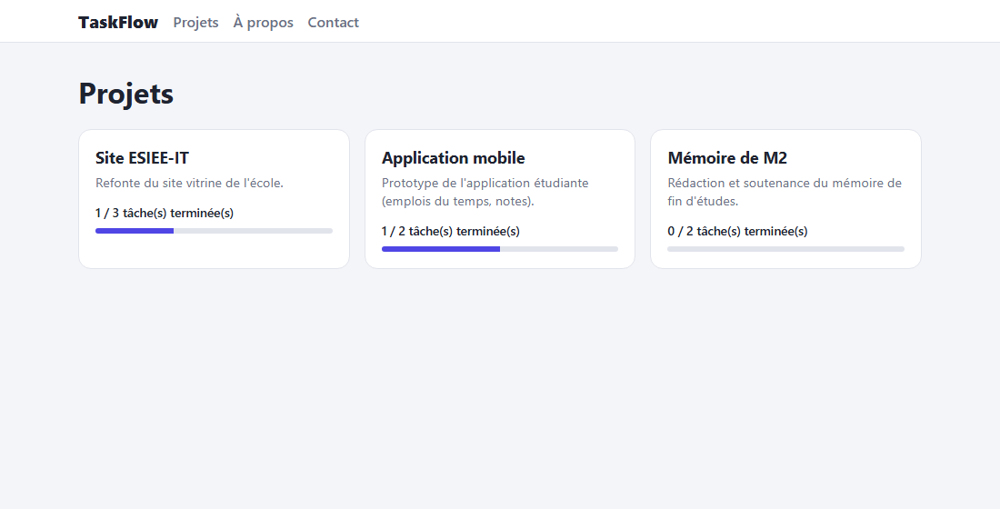

# TaskFlow

Projet fil rouge du module **Développement Web Frontend React + Next.js** (M2 Informatique, ESIEE-IT).

TaskFlow est une petite application de gestion de projets et de tâches, construite en 4 TP :

| TP  | Branche | Contenu | Version en ligne |
| --- | ------- | ------- | ---------------- |
| TP1 | `tp1` | Liste de tâches typée (composants, props, `useState`, listes, filtres) | https://taskflow-tp1-zeta.vercel.app |
| TP2 | `tp2` | Persistance `localStorage`, titre d'onglet, focus auto, priorité, minuteur, thème clair/sombre | https://taskflow-tp2-tan.vercel.app |
| TP3 | `tp3` | Multi-pages avec React Router + API REST (json-server) | https://taskflow-tp3-one.vercel.app (front ; l'API json-server tourne en local) |
| TP4 | `tp4` | La partie lecture refaite en Next.js (dossier `taskflow-next/`) | https://taskflow-tp4.vercel.app |

## Captures d'écran

| TP1 | TP2 |
| --- | --- |
|  |  |
| **TP3** | **TP4** |
|  |  |

## Lancer le projet React (TP1 à TP3)

```bash
npm install
npm run dev        # lance l'API (port 3001) et le site (port 5173)
```

Autres scripts :

- `npm run web` : uniquement le site Vite
- `npm run api` : uniquement json-server sur `http://localhost:3001`
- `npm run db:reset` : remet `db.json` dans son état de départ (copie de `db.seed.json`)
- `npm run build` : vérification TypeScript + build de production

En production, l'adresse de l'API est donnée par la variable `VITE_API_URL` (sinon `http://localhost:3001`).

### Pages (TP3)

- `/` : liste des projets (avec le nombre de tâches terminées et une barre de progression)
- `/projects/:id` : un projet et ses tâches (ajout, changement de statut, suppression → enregistrés dans `db.json`)
- `/projects/new` : création d'un projet (nom de 3 caractères minimum)
- `/tasks` : l'ancienne page du TP2 (tâches perso en localStorage + minuteur)
- toute autre adresse : page 404

## Lancer le projet Next.js (TP4)

```bash
cd taskflow-next
npm install
npm run dev        # http://localhost:3000
```

Les données sont lues directement dans `taskflow-next/db.json` par des composants serveur (pas de json-server, pas de React Router, pas de `useEffect`). Seul `src/components/TaskBoard.tsx` est un composant client (`"use client"`) pour le filtre.

## Bonus réalisés

- TP1 : couleur de la ligne selon la priorité
- TP2 : bouton « Tout effacer » avec confirmation, recherche par titre
- TP3 : suppression d'un projet, barre de progression par projet
- TP4 : page `/contact`, nombre de tâches terminées sur la page d'un projet
